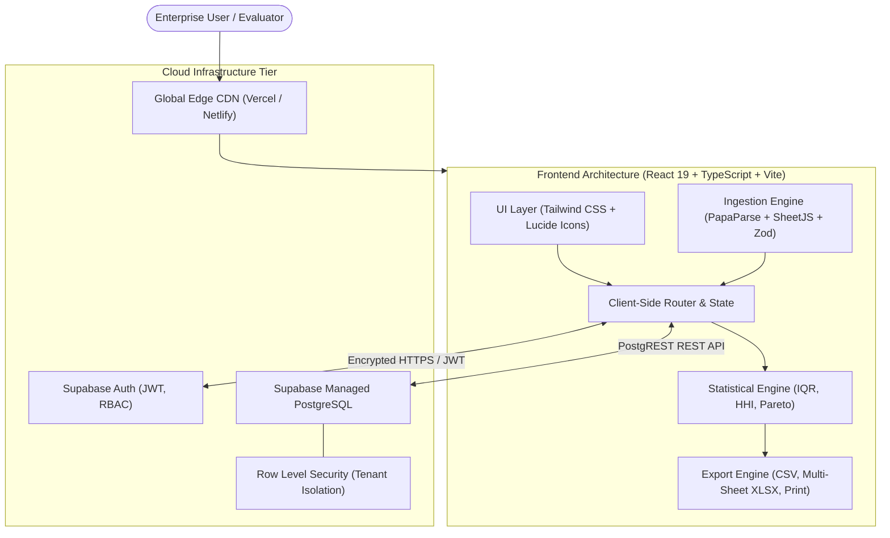
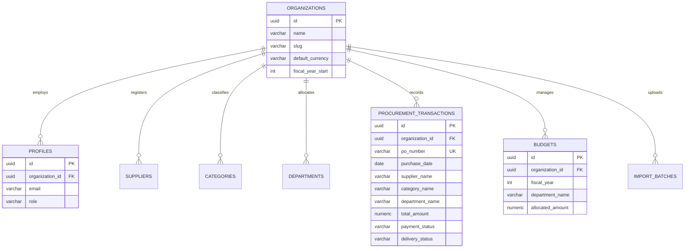

# ProcureSense Cloud — Enterprise Procurement Spend Analytics Platform

[](https://vitejs.dev/)
[](https://react.dev/)
[](https://www.typescriptlang.org/)
[](https://tailwindcss.com/)
[](https://supabase.com/)
[](https://vitest.dev/)
[](LICENSE)

---

## 1. Project Overview

**ProcureSense Cloud** is a production-style, cloud-based procurement spend analytics and governance platform designed for finance leaders, chief procurement officers, and departmental budget holders. The platform transforms fragmented purchasing data into actionable intelligence, providing multi-dimensional expenditure tracking, supplier concentration analysis, departmental budget governance, statistical anomaly detection, and automated report generation.

The project demonstrates real-world **Cloud Computing** principles: multi-tenant database isolation using PostgreSQL Row Level Security (RLS), stateless frontend hosting on global CDNs, zero-trust token-based authentication, and explainable statistical rules for expenditure governance.

---

## 2. Problem Statement

Modern enterprise procurement workflows face several critical operational and financial challenges:
- **Maverick & Off-Contract Spend**: Purchases made outside negotiated corporate rate cards or master service agreements lead to 5%–15% budget leakage.
- **Supplier Concentration Risk**: Over-reliance on single-source vendors without visibility into market share creates supply chain vulnerability.
- **Invoice Collisions & Duplicates**: Accidental duplicate PO submissions and near-identical invoices often escape manual accounting audits.
- **Budget Blindspots**: Fragmented departmental spreadsheets make it impossible to forecast fiscal overruns before month-end closing.
- **Data Ingestion Friction**: Inconsistent ERP file formats (CSV/Excel) require manual schema normalization and data cleaning.

---

## 3. Project Objectives

1. **Centralize Procurement Data**: Provide an automated CSV/Excel ingestion pipeline with fuzzy column mapping, tolerance validation, and duplicate rejection.
2. **Real-Time Financial Governance**: Calculate genuine KPIs (Total Spend, MoM trajectory, Average PO Value, Budget Utilization) directly from stored records.
3. **Supplier Intelligence**: Quantify vendor concentration using the **Herfindahl-Hirschman Index (HHI)** and generate transparent supplier performance scorecards.
4. **Statistical Anomaly Detection**: Implement **Tukey’s Interquartile Range (IQR)** outlier detection to identify suspicious price spikes without black-box ML.
5. **Multi-Tenant Cloud Security**: Enforce tenant isolation at the database layer using Supabase PostgreSQL Row Level Security (RLS) policies.
6. **Audit-Ready Reporting**: Export filtered ledgers in CSV, comprehensive multi-sheet Excel workbooks, and printable executive briefings.

---

## 4. Key Application Features

| Module | Capabilities |
| :--- | :--- |
| **Executive Dashboard** | 8 calculated metrics, monthly spend trajectory (Area chart), category distribution (Donut chart), department budget vs. actual (Bar chart), top suppliers. |
| **Spend Analysis** | Filterable, sortable, and paginated transaction ledger with line-item inspection modal, payment status, and delivery tracking. |
| **Supplier Intelligence** | Vendor directory, spend ranking, order frequency, Herfindahl-Hirschman Index (HHI), and side-by-side benchmarking comparator. |
| **Budget Management** | Fiscal year budget planning, visual progress bars with dynamic warning thresholds (80% warning, 100% overrun), and variance tracking. |
| **Savings & Anomalies** | Tukey IQR outlier detection, 72-hour suspected duplicate invoice alerts, maverick spend detection, and 7% vendor consolidation savings models. |
| **Data Ingestion** | 4-step wizard supporting CSV and Excel (`.xlsx`), intelligent column header auto-detection, Zod schema validation, and duplicate rejection. |
| **Reports & Exports** | Multi-sheet Excel workbook (`.xlsx`), CSV ledger export, printable board briefing view, and security audit logs. |
| **Dual-Mode Data Layer** | Seamless transition between live Supabase Managed Cloud and offline evaluation sandbox with 200+ pre-seeded synthetic records. |

---

## 5. Technology Stack

- **Frontend Framework**: React 19 with TypeScript
- **Build Tool**: Vite 8 with rapid Hot Module Replacement (HMR)
- **Styling**: Tailwind CSS 3.4 with dark/light mode toggle
- **Charts & Visualizations**: Recharts
- **Database & Auth**: Supabase (PostgreSQL 15+ with Row Level Security)
- **Data Validation**: Zod runtime schema validation
- **File Processing**: PapaParse (CSV) and SheetJS / XLSX (Excel workbooks)
- **Icons**: Lucide React
- **Unit & Integration Testing**: Vitest 5 and React Testing Library

---

## 6. System Architecture



---

## 7. Database Design & Row Level Security

The database schema is normalized and version-controlled under `supabase/migrations/`:



### Row Level Security (RLS) Policy Example
Every private table enforces tenant isolation via PostgreSQL RLS:
```sql
CREATE POLICY "Users can only access records in their organization"
    ON public.procurement_transactions
    FOR ALL
    USING (organization_id = (SELECT organization_id FROM public.profiles WHERE id = auth.uid()));
```

---

## 8. Installation & Local Development

### Prerequisites
- **Node.js** v20.x, v22.x, or v24.x LTS
- **npm** v10.x or higher

### Steps

```bash
# 1. Clone the repository
git clone https://github.com/nagavishwa-spidey/procuresense-cloud.git
cd procuresense-cloud

# 2. Install dependencies
npm install --legacy-peer-deps

# 3. Start local development server
npm run dev
```

The application will be live at: **`http://localhost:5173`**

---

## 9. Environment Configuration

Copy `.env.example` to `.env.local`:

```bash
cp .env.example .env.local
```

| Variable | Description | Default |
| :--- | :--- | :--- |
| `VITE_SUPABASE_URL` | Your Supabase project URL | `https://your-project.supabase.co` |
| `VITE_SUPABASE_ANON_KEY` | Public anon key for client-side queries | `your-anon-key` |
| `VITE_APP_NAME` | Display name of the platform | `ProcureSense Cloud` |
| `VITE_DEMO_MODE` | Enable instant evaluator sandbox mode | `true` |

*(Note: If Supabase credentials are omitted, the application automatically runs in full **Evaluation Sandbox Mode** using local state and 200+ pre-seeded records).*

---

## 10. Database Initialization (Supabase Cloud)

To connect your own free-tier Supabase cloud database:
1. Create a free project at [supabase.com](https://supabase.com).
2. Open the **SQL Editor** in your Supabase Dashboard.
3. Paste and run the contents of [`supabase/migrations/20261022000001_initial_schema.sql`](supabase/migrations/20261022000001_initial_schema.sql).
4. Paste and run the contents of [`supabase/migrations/20261022000002_row_level_security.sql`](supabase/migrations/20261022000002_row_level_security.sql).
5. Copy your **Project URL** and **anon public key** from *Settings -> API* into `.env.local`.

---

## 11. Automated Testing

The project includes unit and integration tests powered by Vitest:

```bash
# Run test suite
npm test

# Run tests in watch mode
npm run test:watch
```

### Verified Test Results:
- `src/tests/analytics.test.ts`: Verified KPI calculations, MoM rates, category Pareto 80/20, and HHI index.
- `src/tests/anomaly.test.ts`: Verified Tukey IQR outlier detection and 72-hour duplicate PO matching.
- `src/tests/budget.test.ts`: Verified budget variance formulas and warning threshold triggers (80%, 100%).
- `src/tests/importValidation.test.ts`: Verified fuzzy column mapping, Zod schema validation, and duplicate rejection.
- **Status: 4 test suites passed, 10 tests passed.**

---

## 12. Production Build

```bash
# Compile TypeScript and bundle Vite production assets
npm run build
```

Production artifacts are bundled into `dist/` ready for static CDN deployment.

---

## 13. Cloud Deployment Guide

The application is architected for zero-configuration deployment to static edge providers:

### Deploy to Vercel
```bash
npm install -g vercel
vercel
```

### Deploy to Netlify
```bash
npm install -g netlify-cli
netlify deploy --prod --dir=dist
```

---

## 14. Academic Evaluator Guide & Demo Credentials

When evaluating this project for academic grading or faculty viva:
- Click **"Enter as Admin"** or **"Enter as Analyst"** on the login screen to instantly load the pre-configured enterprise workspace.
- The platform is pre-loaded with **220+ transactions** spanning 12 months, 15 qualified suppliers, 6 departments, and 8 categories.
- **Planted Test Cases**:
  - **IQR Price Outlier**: PO-10221 in *Office Supplies* ($68,500 vs. normal $350 avg).
  - **Duplicate PO Alert**: PO-88412 and PO-88413 with identical amount ($14,250) placed within 24 hours.
  - **Budget Overrun**: *Facilities* tracking at 108% of allocated fiscal budget.
- Click **"Download Template"** in the Import Wizard to test importing additional external CSV files.

---

## 15. Cloud Computing Concepts for Academic Viva

1. **Stateless Frontend Architecture**: The React SPA is completely stateless and hosted across edge CDNs, eliminating server maintenance and allowing infinite horizontal scale.
2. **Database-as-a-Service (DBaaS)**: Uses managed PostgreSQL on AWS via Supabase, with automatic backups, connection pooling, and multi-AZ availability.
3. **Zero-Trust Security & Identity**: Frontend never stores database passwords; communications utilize short-lived JWTs verified cryptographically.
4. **Row Level Security (Tenant Isolation)**: Multitenancy is enforced inside the PostgreSQL query engine, preventing cross-tenant data leaks even if client-side code is compromised.
5. **Data Mesh & Analytics Layer**: Client-side statistical processing reduces cloud computing query costs while providing instantaneous dashboard responsiveness.

---

## 16. License

This project is licensed under the MIT License — see the [LICENSE](LICENSE) file for details.
